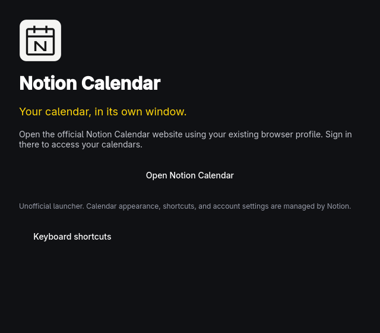

# Notion Calendar for Omarchy

An **unofficial web-app wrapper** for the official <https://calendar.notion.so/>.
Launch **Notion Calendar** from **Super + Space** to open the calendar directly
in a dedicated browser app window, without browser tabs or an address bar.
If its window is already open, the launcher focuses it instead of opening another.

This is not a native calendar client and is not affiliated with Notion. It uses
Omarchy’s supported Chromium-based browser and your existing browser profile;
the website handles sign-in, calendar data, calendar shortcuts, and appearance.
No passwords or calendar data are read or stored by the launcher. Browser
sign-in, cookies, and storage work just as they do in the normal browser.
An internet connection and a Notion Calendar account are required.

## Build, test, install

```sh
bin/build
bin/test
bin/install
```

Built with C++17, Qt Quick, qmake6, and make. Installation uses `makepkg -fsi`
and pacman to install a single launcher binary, desktop entry, and SVG icon.
The package requires Omarchy, Qt 6 base/declarative/Wayland/SVG, and an installed
Chromium-based browser (Chrome, Chromium, Brave, etc.).

```sh
notioncalendar             # Open the calendar directly.
notioncalendar --settings  # Show the native launcher/help screen pictured above.
```

The native screen follows Omarchy’s accent, effective window rounding, and
language live. It ships English, Danish, and Hindi; other languages fall back
to English. The calendar website uses its own language and appearance settings.
Browser launch errors are shown in the native window; network and account
errors are handled by the website.

## Keyboard shortcuts

These apply **only to the native launcher/help screen**, not the calendar:

| Key | Action |
| --- | --- |
| Space | Open calendar |
| ? | Show keyboard shortcuts |
| Q | Quit launcher |
| Escape | Close help |

Inside the calendar, use Notion Calendar’s shortcuts. The launcher never
intercepts typing, calendar shortcuts, undo, or redo in the browser window.

## Development

`src/` is flat: C++ owns launching and live desktop integration, QML owns
layout and interaction. Tests use isolated temporary files and a fake launcher,
and load the real QML offscreen to test buttons, shortcuts, and live Danish
translation. They save English and Danish screenshots under `build/tests/`.
Tests never change the desktop’s theme, language, or browser profile.

The SVG is a custom calendar mark, not an official Notion icon. Theme/language
watching follows Omarchy’s MIT app templates, credited in `LICENSE`.

To uninstall: `sudo pacman -R notioncalendar`. This does not delete browser
data or your calendars.
